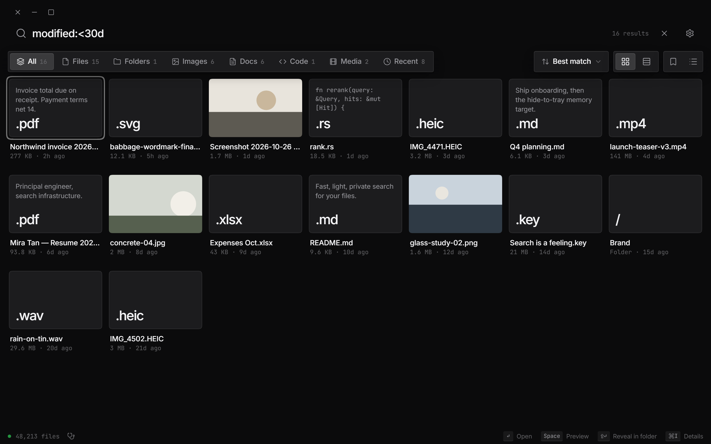
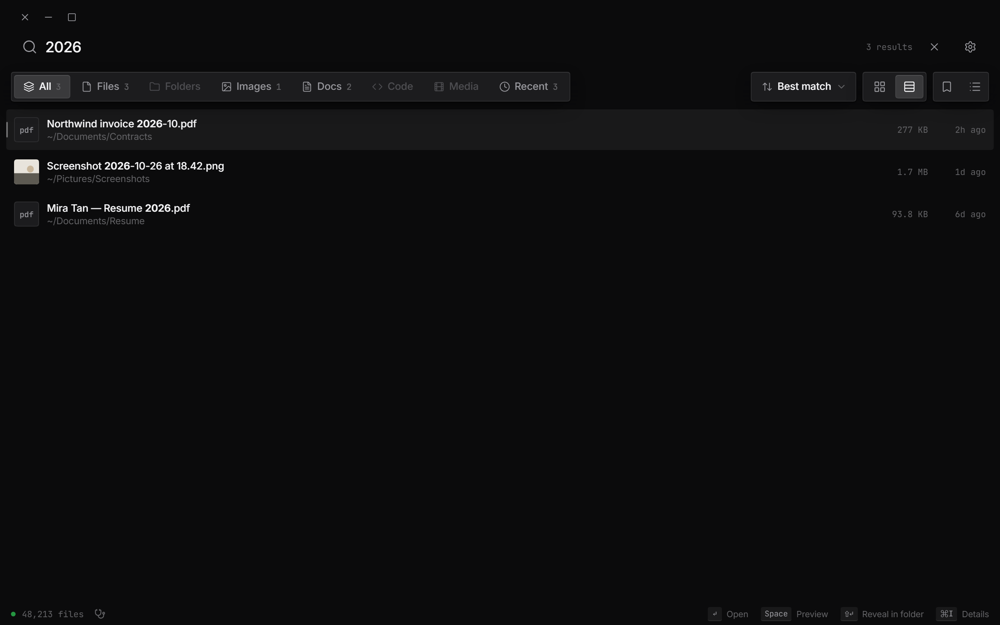
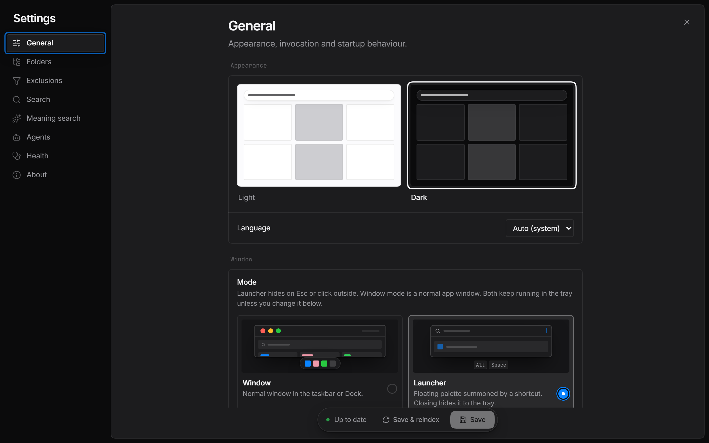
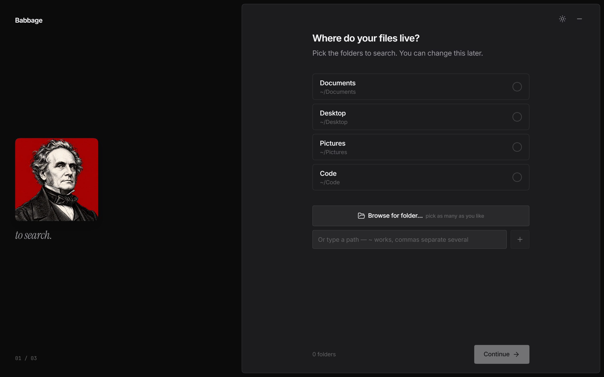
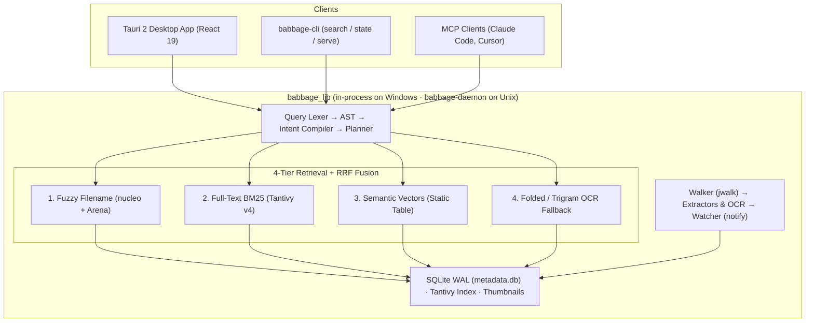

<p align="center">
  
</p>

<h1 align="center">Babbage</h1>

<p align="center">
  <b>Fast, local file and content search for your desktop and AI agents.</b>
</p>

<p align="center">
  <a href="https://github.com/projectGloria/Babbage/actions/workflows/ci.yml"></a>
  <a href="LICENSE"></a>
  
  
  
</p>

<p align="center">
  
</p>

<p align="center">
  <a href="#features">Features</a> ·
  <a href="#screenshots">Screenshots</a> ·
  <a href="#how-it-works">How It Works</a> ·
  <a href="#installation">Installation</a> ·
  <a href="#usage">Usage</a> ·
  <a href="#building-from-source">Building from Source</a> ·
  <a href="#contributing">Contributing</a> ·
  <a href="#license">License</a>
</p>

---

Babbage is a local, offline file and content search engine built with Tauri 2, Rust, and React 19. It indexes filenames, document text, source code, and OCR'd images into one on-disk index so you can find files by what you remember about them — not just their exact name. Both the desktop app and `babbage-cli` (CLI + MCP server) share the same index with zero cloud sync, accounts, or telemetry.

## Features

- **Four-tier hybrid search**: Combines fuzzy filename matching (`nucleo-matcher` over a compact in-memory arena), Tantivy BM25 full-text search with CJK unigram+bigram tokenization, static local semantic embeddings, and OCR-tolerant folded fallback fused with Reciprocal Rank Fusion (RRF).
- **Documents, code, and on-device OCR**: Extracts text from PDF, DOCX, PPTX, XLSX, EPUB, ODT/ODS/ODP, RTF, CSV, plain text, and 50+ code formats, plus on-device OCR for screenshots and scanned PDFs (Tesseract by default, with optional PP-OCRv6 and Indra ONNX engines). Add custom formats without recompiling via opt-in [external extractors](docs/EXTRACTORS.md).
- **Structured query grammar & plain-language intent**: Narrow results with filters (`type:`, `ext:`, `in:`, `path:`, `modified:`, `size:`, `lang:`, `name:`, `content:`, `re:"..."`, `-exclude`, `near[N]`, `mode:exhaustive`) or type natural phrasing like `screenshots from last week` or `latest resume` compiled deterministically on-device.
- **Launcher and desktop window modes**: Summon a floating search palette from anywhere with `Alt+Space`, or run as a standard taskbar/dock window. Keeps the index warm in the system tray, supports light and dark themes, and ships with English, Chinese, and Russian UI locales.
- **Read-only AI agent integration (MCP & CLI)**: `babbage-cli` exposes the local index to Claude Code, Cursor, and shell workflows over stdio MCP (`search`, `read_snippet`, `regex_search`, `index_state`, `health_check`, plus opt-in `reindex`) or a loopback-only token-authenticated HTTP endpoint (`babbage-cli serve`).
- **Private and local by default**: No telemetry, no analytics, and no outbound update checks. Hidden entries, `.ssh`, `.gnupg`, `.aws`, `.kube`, `.docker`, `.env*`, and credential extensions (`.pem`, `.key`, `.pfx`, `.p12`, `.crt`, `.cer`) are excluded by default in both the walker and the agent surface.

## Screenshots

<p align="center">
  
  <br /><em>List view: toggle between grid and list layouts with Ctrl/Cmd+Shift+L, with server-side category facet counts.</em>
</p>

<p align="center">
  
  <br /><em>Settings: switch between Light/Dark themes, UI languages, Launcher vs. Window mode, watched folders, OCR engines, and agent permissions.</em>
</p>

<p align="center">
  
  <br /><em>First-run setup: pick the folders to index and choose your preferred window mode.</em>
</p>

## How It Works



All indexing, extraction, search, OCR, and agent logic lives in the shared `babbage_lib` Rust crate (`src-tauri/`); the React frontend is presentation-only. SQLite in WAL mode is durable truth (tracking files by `(device, inode)` or Windows `file_id` so renames do not trigger re-extraction), while startup builds an in-memory arena with per-name 64-bit character bloom filters for low-latency filename matching. On Unix, the desktop app and CLI prefer `babbage-daemon` over a token-checked socket; on Windows, the desktop app hosts the indexer in-process and CLI/MCP open the index read-only. See [docs/ARCHITECTURE.md](docs/ARCHITECTURE.md) for the full design.

## Installation

Download prebuilt packages from [GitHub Releases](https://github.com/projectGloria/Babbage/releases):

| Platform | Package | Notes |
|---|---|---|
| Windows (x64 / ARM64) | `.exe`, `.msi`, or `babbage-portable-*.zip` | Per-user installer or portable zip (stores data in `data\` beside `babbage.exe`) |
| macOS (Universal) | `.dmg` | Intel + Apple Silicon |
| Linux (x64) | `.AppImage`, `.deb`, `.rpm` | Standalone AppImage or system package |
| Agent CLI | `babbage-cli-*` | Standalone CLI and MCP server binary |

> **Note:** Prebuilt binaries are currently unsigned. On macOS, right-click → **Open** or run `xattr -dr com.apple.quarantine /Applications/Babbage.app`. On Windows, click **More info** → **Run anyway** on the SmartScreen prompt. See [docs/INSTALL.md](docs/INSTALL.md) for full install and shortcut details.

On first launch, Babbage walks you through picking folders to watch and selecting **Launcher** (`Alt+Space`) or **Desktop app** mode.

## Usage

### Desktop search

Type plain words to search filenames and file contents together, or combine filters:

```text
type:pdf invoice
in:~/Projects babbage indexer
modified:<7d config
size:>5mb is:image sunset
name:Cargo content:workspace
re:"TODO|FIXME" ext:rs
screenshots from last week
```

Common shortcuts: `Alt+Space` (toggle launcher), `/` (command menu), `@` (pick folder scope), `Space` (Quick Look preview), `Enter` (open), `Shift+Enter` (reveal in folder), `Ctrl/Cmd+Shift+L` (grid/list toggle), `Ctrl/Cmd+,` (settings). See [docs/USAGE.md](docs/USAGE.md) for the complete query reference.

### CLI

`babbage-cli` queries the same local index from the terminal:

```bash
babbage-cli search "docker error" --limit 10
babbage-cli search "type:pdf invoice" --path ~/Documents
babbage-cli search 're:"fn \w+"' --ext rs --since 30d
babbage-cli search "config" --exhaustive --json
babbage-cli state --json
```

### AI agents (MCP)

Add Babbage to Claude Code, Cursor, or any stdio MCP client (use the absolute path if `babbage-cli` is not on your `PATH`):

```json
{
  "mcpServers": {
    "babbage": {
      "command": "babbage-cli",
      "args": ["mcp"]
    }
  }
}
```

Available tools: `search`, `read_snippet`, `regex_search`, `index_state`, `health_check`, and opt-in `reindex` (disabled by default; requires `"mcp_allow_reindex": true` and a running daemon). See [docs/AGENTS.md](docs/AGENTS.md) for schemas and limits.

## Building from Source

### Prerequisites

- **Rust** stable (edition 2024)
- **Node.js** 20.19+ with `npm` (or **Bun** 1.1+, used by the `Makefile`)
- **Platform build tools**:
  - **Windows**: Visual Studio Build Tools (*Desktop development with C++*) and WebView2 Runtime (preinstalled on Windows 10/11)
  - **macOS**: Xcode Command Line Tools (`xcode-select --install`)
  - **Linux**: `libwebkit2gtk-4.1-dev`, `libgtk-3-dev`, `librsvg2-dev`, `libayatana-appindicator3-dev`, `patchelf` (see [docs/INSTALL.md](docs/INSTALL.md#build-prerequisites) for distro commands)

### Steps

1. Clone the repository and install frontend dependencies:

   ```bash
   git clone https://github.com/projectGloria/Babbage.git
   cd Babbage
   npm install
   ```

2. Run the desktop app in development mode (or `npm run dev` for the browser-only UI preview with example data):

   ```bash
   npm run tauri dev
   ```

3. Build release desktop bundles:

   ```bash
   npm run tauri build
   ```

   Installers are written to `src-tauri/target/release/bundle/` (`nsis/`, `msi/`, `dmg/`, `appimage/`, `deb/`, `rpm/`).

4. Build the standalone CLI and daemon binaries:

   ```bash
   cargo build --release --manifest-path cli/Cargo.toml
   ```

   Binaries are written to `cli/target/release/babbage-cli` and `cli/target/release/babbage-daemon`.

On Unix/macOS, the included [Makefile](Makefile) also wraps common tasks (`make dev`, `make build`, `make cli`, `make test`, `make check`).

<details>
<summary>Running tests and verification checks</summary>

```bash
cargo test --all-targets --manifest-path src-tauri/Cargo.toml
cargo clippy --all-targets --manifest-path src-tauri/Cargo.toml -- -D warnings
npx tsc --noEmit
npm run test
npm run build
```

</details>

<details>
<summary>Data locations and resetting the index</summary>

Babbage stores `config.json`, `metadata.db`, `index/`, `models/`, and `thumbs/` in:

- **Windows**: `%APPDATA%\babbage`
- **macOS**: `~/Library/Application Support/babbage`
- **Linux**: `~/.config/babbage`

Set `BABBAGE_DATA_DIR` to override the location, or place a `portable` file next to the executable to store data in `data/`. To reset local data on Windows, run `.\reset.ps1 -IndexOnly` (or `.\reset.ps1` for a full reset); on Unix/macOS, run `make reset-index` or `make reset`.

</details>

## Documentation

- [Usage & Query Language](docs/USAGE.md)
- [AI Agents (MCP & CLI)](docs/AGENTS.md)
- [Architecture](docs/ARCHITECTURE.md)
- [Configuration](docs/CONFIG.md)
- [External Extractors](docs/EXTRACTORS.md)
- [Install & Build Details](docs/INSTALL.md)
- [Privacy](docs/PRIVACY.md) · [Security](SECURITY.md) · [FAQ](docs/FAQ.md)

## Contributing

Bug reports, documentation improvements, and focused pull requests are welcome. Please read [docs/CONTRIBUTING.md](docs/CONTRIBUTING.md) before opening a PR, and report security vulnerabilities privately as described in [SECURITY.md](SECURITY.md).

## License

MIT License — Copyright (c) 2026 Charles Babbage. See [LICENSE](LICENSE) for details.
